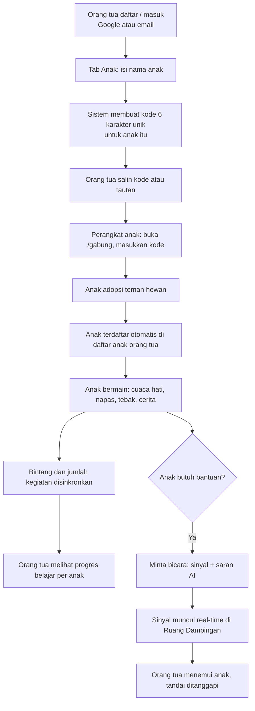
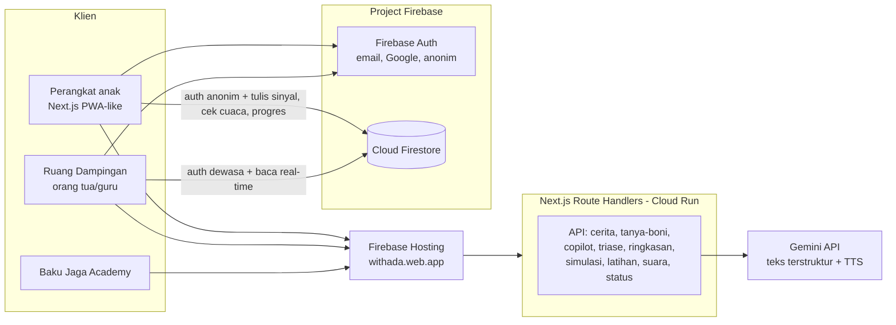

# Catatan Report: Teman Ada (AI Builder Cup 2026)

Rangkuman dari sesi pengerjaan, disusun agar mudah dipindah ke slide submission. Bagian bertanda **[Slide]** sesuai dengan slide kosong di template (Process flow / Use-case, Wireframes, Architecture, Technologies).

> Tidak ada kunci API atau nilai `.env` di dokumen ini. Isi `.env.local` jangan masuk ke report.

---

## 1. Ringkasan produk

- **Nama:** Teman Ada (sebelumnya "Ruang Rasa"). Tagline usulan: "Selalu ada, di cuaca apa pun."
- **Apa ini:** platform kesehatan mental berbasis WHO (HAT/EASE) dan MHFA untuk anak SD. Anak berlatih mengenali dan menenangkan perasaan bersama teman hewan. Orang dewasa yang dipercaya (orang tua/guru) menerima sinyal saat anak butuh bantuan, dan dilatih lewat Baku Jaga Academy.
- **Tiga pengguna:** anak (perangkat anak), orang tua/guru (Ruang Dampingan), peserta pelatihan guru (Academy).
- **Aturan keras:** tidak ada chat bebas antara AI dan anak. AI bekerja di belakang layar atau untuk orang dewasa. Ini nilai jual untuk keamanan.
- **Teman hewan:** badak (Boni), burung nuri, penyu. Anak bebas memberi nama sendiri.
- **Bahasa:** Indonesia dan Inggris (saklar ID/EN).

## 2. Fitur **[Slide: daftar fitur]**

### Sisi anak
| Fitur | Fungsi | AI? |
|---|---|---|
| Adopsi teman | Pilih hewan dan beri nama sendiri | - |
| Cek cuaca hati | Pilih cuaca (cerah/mendung/hujan/badai) + bagian badan yang terasa | Triase level |
| Napas (P3K perasaan) | Latihan napas, lalu "lebih baik / masih berat" | - |
| Tebak perasaan | Permainan mengenali ekspresi | - |
| Cerita | Cerita pendek berpilihan | - |
| Cerita Ajaib | Cerita baru buatan AI dengan nama teman anak | Gemini |
| Tanya teman | Pertanyaan terpilih tentang perasaan (bukan chat bebas) | Gemini |
| Minta bicara (Aman) | Mengirim sinyal ke orang dewasa tepercaya | Gemini (saran) |
| Pohon bintang | Bintang dari tiap kegiatan | - |

### Sisi orang tua/guru (Ruang Dampingan)
| Fitur | Fungsi |
|---|---|
| **Anak (baru)** | Buat kode unik per anak dengan nama anak, daftar anak terhubung, progres belajar per anak |
| Sinyal | Sinyal dari anak secara real-time, level (aman/perhatian/segera), saran AI, tombol "sudah ditanggapi" |
| Tanya pendamping (Copilot) | Tanya situasi nyata, dijawab Gemini dari korpus MHFA dengan kutipan sumber dan rujukan |
| Tren | Rekap cuaca hati 7 hari + ringkasan AI |

### Baku Jaga Academy (guru)
Pre-test, materi, latihan simulasi, post-test, sertifikat (kode verifikasi), dashboard pelatih (kohort, skor pre/post). Rubrik **B-A-K-U**: Berhenti dan tenang, Akui perasaan, Kasih dengar, Uruskan bantuan.

## 3. Alur proses dan use-case **[Slide: Process flow / Use-case]**



**Use-case (aktor dan tujuan)**
- **Anak:** mengenali perasaan, menenangkan diri, meminta bantuan orang dewasa tanpa harus membaca (ikon dan suara).
- **Orang tua/guru:** menghubungkan lebih dari satu anak, menerima sinyal, memantau tren emosi dan progres belajar, bertanya ke Copilot.
- **Peserta pelatihan:** belajar menanggapi anak dengan rubrik B-A-K-U, mendapat sertifikat.
- **Pelatih:** memantau kohort dan hasil pre/post.

## 4. Wireframe/Mock **[Slide: Wireframes]**

Screenshot yang bisa dipakai (ambil dari aplikasi live):
1. **Rumah anak:** teman hewan + gelembung sapaan, tombol cek cuaca, 6 kartu kegiatan, pohon bintang.
2. **Cek cuaca:** 4 ikon cuaca besar.
3. **Gabung (perangkat anak):** input kode 6 karakter.
4. **Ruang Dampingan, tab Anak:** form "Tambah anak", kartu anak (nama, kode, status Terhubung/Menunggu, bintang, kegiatan per jenis, terakhir aktif).
5. **Ruang Dampingan, tab Sinyal:** kartu sinyal dengan level berwarna dan saran AI.
6. **Ruang Dampingan, tab Tren:** batang cuaca 7 hari.
7. **Academy:** pre-test, materi, latihan, sertifikat, dashboard pelatih.

## 5. Arsitektur **[Slide: Architecture]**



**Model data (Firestore)**
```
users/{uid}                       profil: peran, nama, ruangKode, ruangNama
rooms/{kode}                      1 anak = 1 ruang: ownerUid, nama(anak), dibuat
  anggota/{uid anak}              nama teman, species, stars, progres{kegiatan: n}, aktifTs
  signals/{id}                    to, weather, body, level, status, alasan, saran, ai, anakUid
  checkins/{id}                   weather, body, level, anakUid, ts
akademi/{uid}                     hasil pre/post, poin, tahap, benar per soal
```

**Prinsip keamanan**
- Kode 6 karakter acak (tanpa karakter mirip 0/O, 1/I) sebagai kunci masuk perangkat anak.
- Anak memakai akun anonim, tanpa email anak. Orang dewasa memakai akun terdaftar.
- Hanya pemilik ruang yang dapat membaca sinyal, cek cuaca, dan progres.
- Kunci Gemini hanya di server, tidak pernah dikirim ke browser.
- Nama teman dibersihkan (`namaAman`) sebelum masuk prompt AI.
- Pengaman AI: level tertinggi tidak dibalas AI ke anak, langsung tampil ke orang dewasa. Batas laju per jenis permintaan.

Aturan final ada di `rules.md` / `firestore.rules`.

## 6. Teknologi **[Slide: Technologies]**

| Lapisan | Teknologi |
|---|---|
| Framework | Next.js 16.4 (App Router, cacheComponents, Turbopack), React 19 |
| Bahasa & gaya | TypeScript 5, Tailwind CSS 4, font Baloo / Nunito / Plus Jakarta |
| Auth & data | Firebase Authentication (email, Google, anonim) dan Cloud Firestore (real-time `onSnapshot`) |
| AI | Gemini API (Interactions API): teks terstruktur JSON dengan urutan fallback model, dan TTS. Model dikonfigurasi lewat env |
| Penyimpanan lokal | localStorage (progres lokal, bahasa, suara) |
| Hosting target lomba | Google Cloud: Cloud Run + Firebase Hosting (`withada.web.app`) |
| Hosting sementara | Netlify (`ada-ai-builder-cup.netlify.app`) |
| Kualitas | ESLint, `tsc --noEmit`, `next build` |
| Aset | Ilustrasi karakter gaya geometric flat (prompt di `resource/prompt-gemini.md`) |

## 7. Aturan lomba dan keputusan hosting

- Situs lomba menyatakan prototipe harus dibangun **"on Google Cloud"** (halaman utama tidak menyebut Cloud Run atau Firebase secara spesifik). `PLAN.md` mencatat solusi di cloud lain tidak dinilai. Halaman Challenges & Requirements dan Terms belum terbaca, sebaiknya dicek ke panitia.
- **Deadline:** 18 Okt 2026, 23:59 UTC (19 Okt 06:59 WIB).
- Tim 2 sampai 4 orang, tidak boleh ada pelajar, usia minimal 21.
- **Keputusan:** Netlify tidak dijadikan link utama. Deploy ke **Cloud Run**, dengan **Firebase Hosting `withada.web.app`** sebagai pintu depan (rewrite ke Cloud Run). Firebase Spark tidak cukup (tidak bisa menjalankan 9 API server), jadi dipakai project teman tim (`withada-94d68`) yang billing/Blaze-nya aktif.
- **Hasil:** live di **https://withada.web.app** (Cloud Run service `teman-ada`, region `asia-southeast1`, image di Artifact Registry, build via Cloud Build).
- Firestore dan Auth tetap di project `ai-builder-cup-d5a41`; yang berpindah hanya tempat aplikasi berjalan. Tambahkan `withada.web.app` ke Authorized domains Auth.

Langkah akses: teman tim menambahkan akun lewat Firebase Console, Project settings, Users and permissions, Add member (role Owner/Editor), lalu upgrade ke Blaze di pojok kiri bawah Console.

## 8. Riwayat perubahan sesi ini

1. **Bug nama teman:** nama yang diinput kembali jadi "Boni" karena server hanya menerima daftar nama tetap. Diganti `namaAman()` (nama bebas, dibersihkan, maks 16 karakter). Pesan fallback "Boni sedang sulit menjawab" memakai nama teman.
2. **Rebranding** Ruang Rasa menjadi Teman Ada (judul, landing, halaman anak/mulai, dokumen). Key localStorage lama sengaja dipertahankan agar data pengguna tidak hilang.
3. **Multi-anak + progres:** kode unik per anak (nama anak), tab Anak, daftar anak terhubung real-time, progres belajar (bintang, kegiatan per jenis, terakhir aktif), pilih anak untuk Sinyal/Tren. `addStar` kini mencatat jenis kegiatan; `SinkronAnak` mengirim progres ke Firestore.
4. **Copy:** judul hasil Tebak Perasaan menjadi "Terima kasih sudah bermain!" / "Thanks for playing!".
5. **Bug daftar anak kosong:** rules lama menolak `list` pada `rooms`. Ditambah error yang terlihat dan fallback ruang dari profil.
6. **Rules Firestore final:** list hanya untuk pemilik, `ownerUid` tak bisa diganti, validasi `anggota`, `signals` dibatasi per peran. Dokumen: `rules.md`.
7. **Deploy:** commit `7acfdeb` ke `main`, deploy production Netlify (build lolos).
8. **Deploy ke Google Cloud:** `Dockerfile` + `cloudbuild.yaml`, Cloud Run `teman-ada`, Firebase Hosting `withada` dengan rewrite ke Cloud Run. `/api/status` dibuat dinamis (`connection()`) agar membaca env saat runtime.

## 9. Batasan dan pekerjaan lanjutan

- Progres belajar hanya terkirim dari kegiatan setelah fitur multi-anak aktif.
- Belum ada tombol hapus atau ganti nama anak.
- Rules belum diuji di emulator; uji alur penuh setelah publish.
- `akademi` terbaca semua akun dewasa (sengaja, untuk dashboard pelatih); batasi bila data nyata.
- Kode 6 karakter bisa ditebak lewat brute force (risiko rendah karena ruang kosong tidak membocorkan data).
- Menghapus ruang tidak menghapus subkoleksinya.
- Env Gemini di Cloud Run berupa env var biasa; Secret Manager lebih rapi untuk jangka panjang.
- Variabel `NEXT_PUBLIC_*` tertanam saat build, jadi perubahan config Firebase butuh build ulang image (lihat `cloudbuild.yaml`).

## 10. Checklist sebelum submit

- [x] Cloud Run live dan `withada.web.app` mengarah ke sana
- [ ] `withada.web.app` ada di Authorized domains Firebase Auth (project `ai-builder-cup-d5a41`)
- [x] Env `NEXT_PUBLIC_FIREBASE_*` (build arg) dan `GEMINI_API_KEY` (runtime) terisi di Cloud Run
- [ ] Rules Firestore ter-publish (sudah, per screenshot Console)
- [ ] Uji alur penuh: daftar orang tua, buat kode anak, gabung dari HP lain, kirim sinyal, lihat progres
- [ ] Slide: process flow, wireframe, arsitektur, teknologi terisi
- [ ] Video demo kurang dari 3 menit dan README dirapikan
- [ ] Submit beberapa jam sebelum deadline (anggap batasnya 18 Okt malam WIB)
